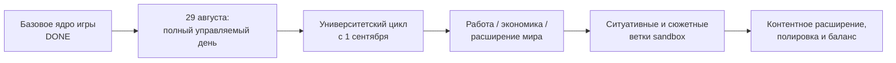

# Nastya Story — Development Board

> **Оперативная панель разработки.** Это не источник игрового канона и не замена [`IMPLEMENTATION_ROADMAP.md`](IMPLEMENTATION_ROADMAP.md). Подробный статус систем — в Roadmap, требования — в канонических спецификациях, конкретная реализация — в TASK.
>
> **Последняя сверка:** 2026-09-15.

## 🎯 Текущая цель

**Сделать 29 августа полноценным первым управляемым игровым днем:** выход из квартиры, район, университет, обязательные цели дня, базовая экономика и интерфейсы без прототипных заглушек.

## 🚦 Сейчас

| Стадия | Работа | Что дальше |
|---|---|---|
| ✅ **DONE** | [`TASK-007`](tasks/done/TASK-007_hud_navigation_actions_dialogue_layout.md) — HUD: переходы/действия, dialogue-mode, notify и навигация Центрального района | Реализовано и проверено Codex |
| 🟢 **READY / RECHECK** | [`TASK-000`](tasks/ready/TASK-000_IMPORT_EXISTING_SPECS.md) — импорт существующих спецификаций | **Не запускать автоматически:** требование выглядит историческим, так как целевые спецификации уже находятся в `docs/systems/`; перед исполнением проверить актуальность |
| ✅ **DONE** | [`TASK-008`](tasks/done/TASK-008_items_wardrobe_intimate_status_hud.md) — унифицированные items, единый wardrobe, вкладка `Интимное`, persistent body items и status HUD | Проверено и принято владельцем 2026-09-08 |
| 🟣 **REVIEW** | [`TASK-009`](tasks/review/TASK-009_phone_ui_contacts_quests_calendar_messages.md) — телефон: smartphone UI, контакты, задания, календарь и сообщения | Замечания к приложениям устранены; FULL_LOCAL пройден. Повторная приемка владельцем; cooldown и тексты бытовых ответов остаются неутвержденными |
| ✅ **DONE** | [`TASK-010`](tasks/done/TASK-010_arousal_intimate_actions_remote_toy_sleep_hud.md) — шкала возбуждения, интимные действия, remote toy, сон, compatibility и HUD | Принято владельцем 2026-09-14; опубликовано в `main` |
| ✅ **DONE** | [`TASK-011`](tasks/done/TASK-011_ui_review_pass_1.md) — первый UI review-pass: HUD, одношаговые действия, phone quest/calendar и системные меню | Принято владельцем 2026-09-15; финальный tooltip-fix проверен, опубликован и синхронизирован |
| ✅ **DONE** | [`TASK-012`](tasks/done/TASK-012_narrator_body_lexicon_register.md) — регистр телесной лексики в авторской речи (только правила) | Принято владельцем 2026-10-30 |
| 🟣 **REVIEW** | [`TASK-013`](tasks/review/TASK-013_intimate_physiology_plausibility.md) — справочник реальной интимной физиологии (только документация) | Ожидает приемки владельцем |

`TASK-002`, `TASK-004` и `TASK-006` завершены и приняты владельцем. Для TASK-002 финальная синхронизация runtime transitions с каноническим `map.drawio` выполнена 2026-09-06 на уровне `REMOTE_LIMITED`; первоначальная миграция ранее проходила локальные Ren'Py-проверки.

## 🧭 Ближайшая очередь продукта

Порядок ниже берется из текущего `IMPLEMENTATION_ROADMAP.md`. Перед созданием каждого TASK необходимо сверять соответствующую каноническую спецификацию и фактический код.

| Приоритет | Направление | Текущий сводный статус | Следующий результат |
|---:|---|---|---|
| **P0** | Спальный район и переходы первого дня | ✅ DONE | Выход, район и нужные точки первого дня работают по актуальному `map.drawio` |
| **P0** | Транспорт между гиперкластерами | ✅ DONE | Автобус район ↔ университет работает с расходом времени |
| **P0** | Обязательные действия квеста 29 августа | ✅ DONE | Документы, поиск работы, посещение Ники и дополнительные цели проходят через общий event/quest runtime |
| **P0** | Университет 29 августа | ✅ DONE | Подача документов, маршрутный дедлайн, обязательное отправление и приложение реализованы |
| **P0** | Завершение 29 августа | ✅ DONE | Обязательный сюжетный финал дня отменен решением владельца; одноразовая беседа о поступлении доступна до 1 сентября, дальнейшее время и сон работают по общим правилам |
| **P1** | Магазин и базовая покупка | ✅ DONE | Девять позиций магазина и девять позиций кафе, округленные цены, покупка и немедленное употребление заказов |
| **P2** | Унификация торговых интерфейсов | 📋 PLANNED | Спроектировать единый UI-контракт для магазинов, кафе и будущих торговых объектов на базе компонентов инвентаря и гардероба |
| **P1** | Питание, голод, cooldown и временные HUD-эффекты | 🟡 PARTIAL | Порог 5+1 часов, замедление во сне, полноценная еда, перекусы и энергетик реализованы; остаются повторная еда и будущий университетский обед |
| **P1** | Телефон первого дня и университетское приложение | 🟡 PARTIAL | Рабочие нужные приложения и разблокировка после документов |
| **P1** | Карточки персонажей | 🟡 PARTIAL | Карточка Маши открывается; карточка Насти приведена к системе |
| **P1** | Унификация UI и реальные ассеты | 🟡 PARTIAL | Убрать текстовые/символьные заглушки, привести экраны к UI Design System |
| **P2** | Ситуативные события первого дня | 🟡 PARTIAL | Первый производственный набор событий с условиями/cooldown |
| **P2** | Университетский цикл с 1 сентября | 🔴 NOT_STARTED / поэтапно | Полноценная учебная петля после завершения первого управляемого дня |

## 🏗 Крупные этапы

Точные границы поздних этапов будут уточняться по мере фиксации канона. Эта схема показывает направление, а не утверждает отсутствующие в спецификациях детали.

## ✅ Принятые TASK

| TASK | Результат |
|---|---|
| [`TASK-001`](tasks/done/TASK-001_hud_fullcolor_buttons.md) | HUD — полноцветные кнопки |
| [`TASK-002`](tasks/done/TASK-002_apartment_5_canon_sync_cleanup.md) | Квартира №5 переведена на стабильные ID, legacy-модель удалена, runtime transitions синхронизированы с `map.drawio` |
| [`TASK-003`](tasks/done/TASK-003_sync_minimal_starting_wardrobe.md) | Синхронизация минимального стартового гардероба |
| [`TASK-004`](tasks/done/TASK-004_unpack_luggage_and_grooming.md) | Разбор чемоданов, grooming и закрытая UI-regression одноразового действия |
| [`TASK-005`](tasks/done/TASK-005_ui_restoration_pass.md) | Восстановительный проход по UI |
| [`TASK-006`](tasks/done/TASK-006_relationship_model_and_incest_selector.md) | Kinship/social/intimacy, глобальный selector родственников, migration и regression coverage |
| [`TASK-008`](tasks/done/TASK-008_items_wardrobe_intimate_status_hud.md) | Унифицированные items/wardrobe и status HUD; принято владельцем 2026-09-08 |
| [`TASK-011`](tasks/done/TASK-011_ui_review_pass_1.md) | UI review-pass 1 принят владельцем 2026-09-15; финальное позиционирование tooltip проверено в локальном runtime |
| [`TASK-012`](tasks/done/TASK-012_narrator_body_lexicon_register.md) | Регистр телесной лексики в авторской речи; принято владельцем 2026-10-30 |

## ⚠ Блокеры и точки внимания

- `TASK-007` завершена: `0dd93b3`, локальные lint/runtime и визуальная проверка выполнены; UI-источник синхронизирован.
- `TASK-008` завершен и принят владельцем 2026-09-08. Неутвержденные nutrition thresholds и финальные item/clothing assets остаются `TBD` и отдельным пулом работ; текущий продуктовый фокус первого дня не меняется.
- `TASK-009` находится в `review`: переработаны телефон и приложения `Контакты`, `Задания`, `Календарь`, `Сообщения`; банк исключен из TASK.
- `TASK-011` завершен и принят владельцем 2026-09-15; финальный tooltip-fix опубликован в `main` и подтвержден в локальном runtime, синхронизация локальной `main` выполнена успешно.
- По прямому поручению владельца реализован и принят 2026-09-15 отдельный банковский модуль поверх единого wallet: история, займы у Ники, банковский кредит, погашение и инфраструктура сюжетных переводов.
- Прямое поручение P0 первого дня было принято по результатам локальной приемки и опубликовано в коммите `c07f293`: вступление 29 августа, документы и защита дедлайна, вакансии, визит к Нике 19:00–22:00 и минимальное приложение института. Позднейшим решением владельца финальная сцена сна и фиксированное пробуждение отменены; самостоятельная одноразовая беседа до 1 сентября, общий почасовой сон, расход энергии по времени и приложение «Будильник» реализованы и приняты владельцем 2026-09-15.
- `docs/graphs/map.drawio` — единственный канонический источник топологии. Старые Mermaid-графы удалены и не должны восстанавливаться как параллельные источники.
- Внутренняя и необходимая для первого дня внешняя runtime-навигация синхронизированы с картой и проверены.
- `TASK-000` требует проверки актуальности до запуска: целевые системные спецификации уже существуют в репозитории.
- Цена упаковки одноразовых бритв остается каноническим `TBD`; это относится к будущей работе магазина/баланса и не блокирует завершенный TASK-004.
- Relationship model TASK-006 завершена: kinship/social/intimacy и глобальный selector `Отношения с родственниками` находятся в `main`; FULL_LOCAL проверка прошла.
- Локальный regression/visual-контур Ren'Py сохранен для последующих задач; testcase suite умеет проверять HUD/profile и luggage before/after.
- В `IMPLEMENTATION_ROADMAP.md` отдельные ссылки на старые TASK могут описывать лишь частичный технический вклад, а не полноценную реализацию всей системы; перед реализацией всегда сверять фактический код и implementation reports.
- Self-hosted GitHub Actions runner `ANOVI-HW` подключен и локальная синхронизация работает. Так как рабочая копия находится на переносном диске `T:`, runner используется в ручном режиме START/STOP и штатно остается Offline, пока внешний диск не подключен.

## 🔄 Правило актуализации

Эту доску проверяют **ChatGPT и Codex** при любой работе, меняющей состояние разработки.

Обновить доску нужно, если:

- TASK создан, начал выполняться, ушел в review или принят;
- изменился ближайший приоритет;
- появился/исчез блокер;
- изменился сводный статус крупной системы;
- результат реализации делает одну из строк выше неверной.

При изменении фактического статуса системы одновременно проверить [`IMPLEMENTATION_ROADMAP.md`](IMPLEMENTATION_ROADMAP.md). Подробности реализации сюда не переносить.

Рабочий регламент: [`DEVELOPMENT_WORKFLOW.md`](DEVELOPMENT_WORKFLOW.md).

Синхронизация навигации 7 сентября: все пространства карты и маршруты внесены в runtime; доступны открытые точки района, автобус и вход в институт. Неопределенные доступы, художественные ассеты и квестовые действия не завершены. [Проверки и ограничения](graphs/WORLD_NAVIGATION_REPORT.md).
